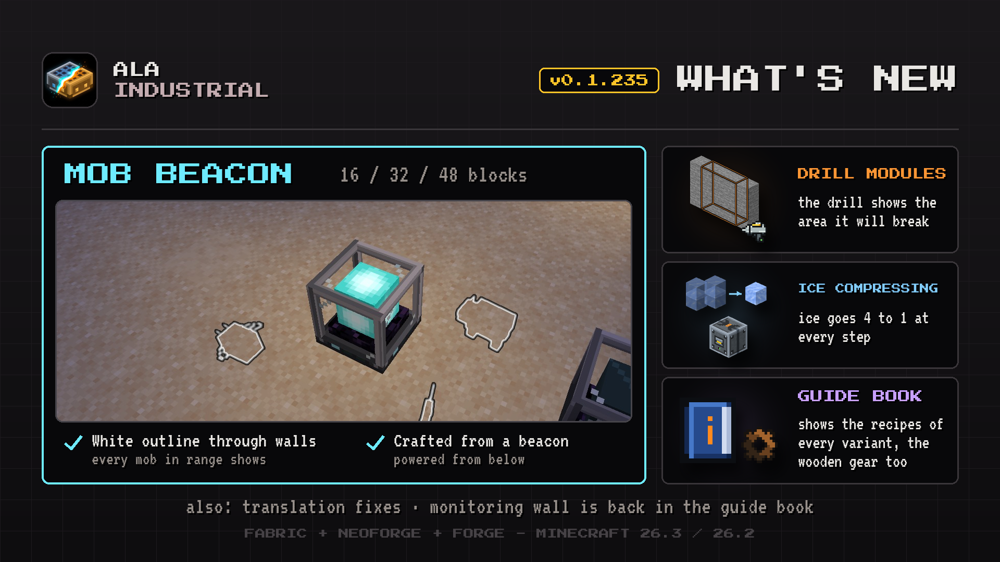

# Changelog

## 0.1.235

A new Mob Beacon outlines mobs through walls, the drill shows the area it is about to break, and compressor ice now takes four of the previous step.

### New

- **Drill area outline.** A drill with bore modules now outlines every block it is about to break, in the game's own block outline, so you can aim the whole area.
- **Mob Beacon.** While powered, it outlines every mob within 16, 32 or 48 blocks through walls, in three sizes crafted up from a vanilla beacon. Power goes in from below only.

### Improved

- **To-do Clipboard in the guide book.** The clipboard now has its own page with the recipe in the in-game guide book, in every language.
- **Guide Book families.** A family page now pages through the recipes of all its variants, the Wooden Gear included, and notes when any kind of an item fits.
- **Compressor ice.** Each step now takes 4 of the previous one: snow blocks to ice, ice to packed ice, packed ice to blue ice. Blue ice costs 64 snow blocks, still five times cheaper than crafting.

### Bug Fixes

- **Energy with other tech mods, correction.** The mod's cables pass energy into batteries and machines of other mods, but not into their cables. Join the networks through a battery or a machine.
- **Monitor Wall in the Guide Book.** Its entry is back under Other, with the recipes of the Monitor Core, the Smart Wire, the Monitor Panel and the capacity card.
- **Translations.** Boat and raft names in Bengali are now fully translated, and leftover English words in Dutch, Indonesian and Turkish are translated too.
