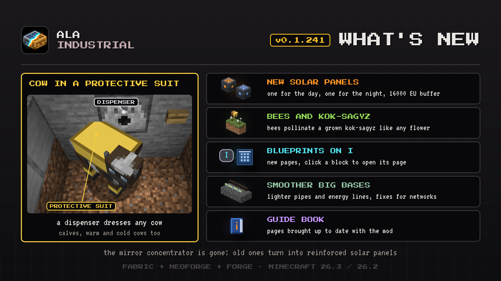

# Changelog

## 0.1.241

This release tidies up the mod: smoother big bases, new day and night solar panels, blueprints for newer content and a protective suit for cows.

### New

- Blueprints (hold I) for all the newer content: elevator, escalator, work town, concrete, mob beacons, thermoelectric generator, reactor watch, slingshot and more.

### Improved

- Energy lines with hundreds of machines plan each tick faster. Power is shared out exactly as before.
- Long item pipe lines and monitor walls no longer rebuild themselves whenever a block next to them changes, which lowers server load around busy storage.
- The Mirror Concentrator gives way to full-block tier 3 solar panels. Old concentrators become the Reinforced Solar Panel; their sections drop as Machine Casings, and cables to them need reconnecting.

### Bug Fixes

- Pipes from other mods can now reach the quarry's socket foundation in every build of the mod. A formed frame's socket can no longer be pushed by a piston.
- In some builds of the mod, another mod's machine that only takes energy is no longer treated as a generator too, so cable networks next to it can idle and the Network Analyzer lists it correctly.
- Unloading long item or fluid pipes and monitor walls no longer rebuilds their networks on the spot, which removes a possible hang on Saving world and a stutter when chunks unload.
- The elevator panel does less work per press and per tick, and a teleport remote with a huge station limit no longer risks an oversized network packet.
- A base solar panel that grows into the Daylight or Moonlit Panel now keeps its upgrade chips in the same slots instead of dropping them on the ground.
- Dispensers now put the shielding suit on cows instead of dropping it, and the suit shows on them: a gas mask, a blanket with straps, gaiters and boots, on every cow and on calves.
- Bees now pollinate kok sagyz once it reaches its seed head, just like a vanilla dandelion. Younger stages are ignored.
- Full-block solar panels now show the four corner bolts of their design; the Moonlit Solar Panel grows into the Bronze Lunar Panel with a Lunar Evolution Chip too.
