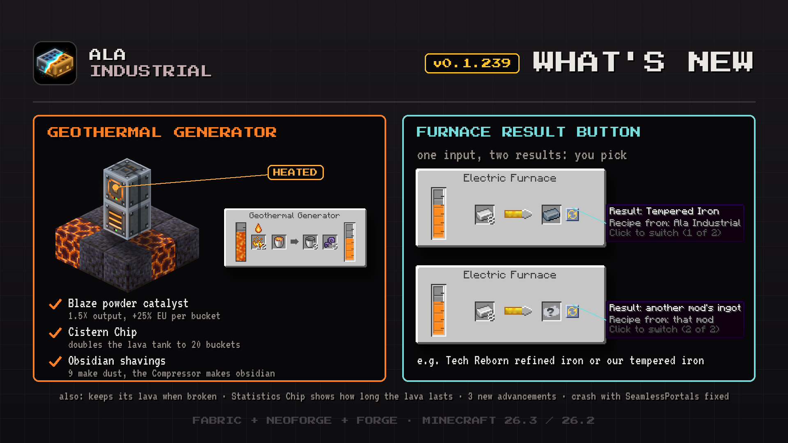

# Changelog

## 0.1.239

This update turns the Geothermal Generator into a real lava station and lets furnaces pick between results from different mods.

### New

- **How long the lava lasts.** With the statistics chip, the Geothermal Generator shows how many minutes its lava lasts and its load. It no longer burns lava when the energy has nowhere to go.
- **Geothermal advancements.** Three new advancements for the Geothermal Generator: First Lava, Bucket That Pays Off and Station.
- **Result button for furnaces.** When another mod's furnace recipe takes the same item, the Electric Furnace and Iron Furnace show a button to pick which result to make.
- **Geothermal heat.** A running Geothermal Generator heats the machine standing on it like a lava block, so a Vulcanizer on top needs no other heat.
- **Obsidian shavings.** The Geothermal Generator leaves a shaving for every bucket of lava it burns. Nine make obsidian dust, and the Compressor turns the dust into obsidian.
- **Cistern Chip.** A new upgrade chip doubles the Geothermal Generator's lava tank to 20 buckets.
- **Blaze catalyst.** Blaze powder in the Geothermal Generator's new slot gives 1.5x output and a quarter more energy per bucket of lava, one powder per bucket.
- **Lava statistics.** The statistics chip in a Geothermal Generator counts the lava burnt and the energy each bucket gave.

### Improved

- **Lava stays inside.** A broken Geothermal Generator keeps its lava in the item and puts it back in the tank when placed again.

### Bug Fixes

- **Portal crash.** The game no longer crashes when you look into a portal from a mod that draws another world inside it.
