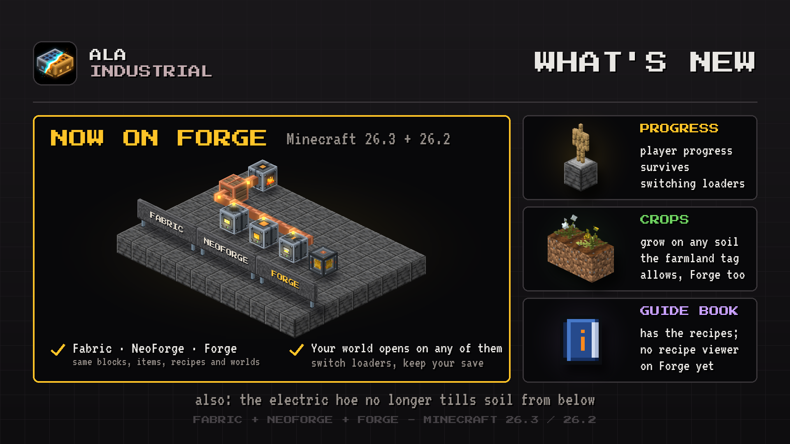

# Changelog

## 0.1.233

Keeps the Minecraft 26.3 builds in step with 26.2, with one small fix in the Guide Book.

### Improved

- **Guide Book.** The mob wheel page shows the wheel itself, with the same icon in every language.
