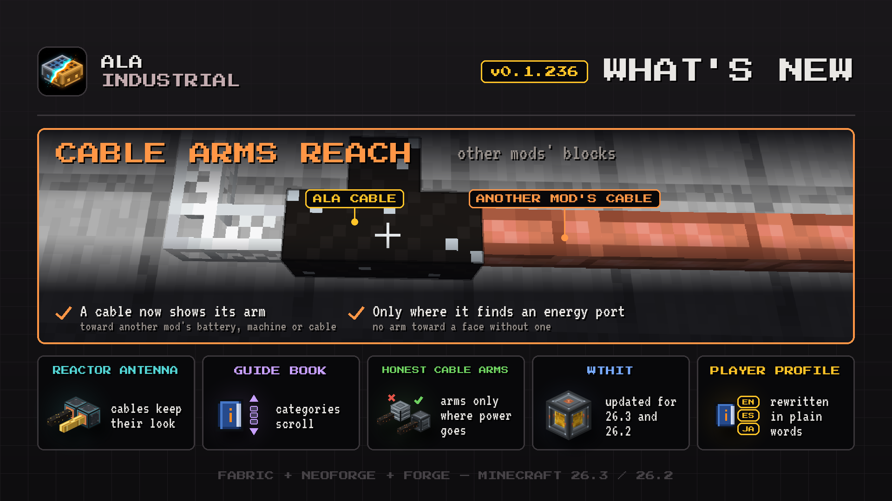

# Changelog

## 0.1.236

Cables now show their arm toward other mods' energy blocks, the reactor antenna takes a cable in its own look, and the guide book fits small windows.

### Improved

- **Guide book.** The Player Profile entry is rewritten in plain words in every language.

### Bug Fixes

- **Cable arms tell the truth.** The crystal farm controller shows an arm on its panel face, where it takes power; the storage module, which has no energy, shows none.
- **Reactor antenna.** A joining cable keeps its own look all the way in, with no gap at the joint, and the antenna's socket is larger, framed round the plug.
- **Guide book on a small window.** Category buttons stay inside the book; extra categories scroll with arrows or the mouse wheel.
- **Cable arms toward other mods' blocks.** A cable now shows its arm toward another mod's battery, machine or cable when that face has an energy port.
