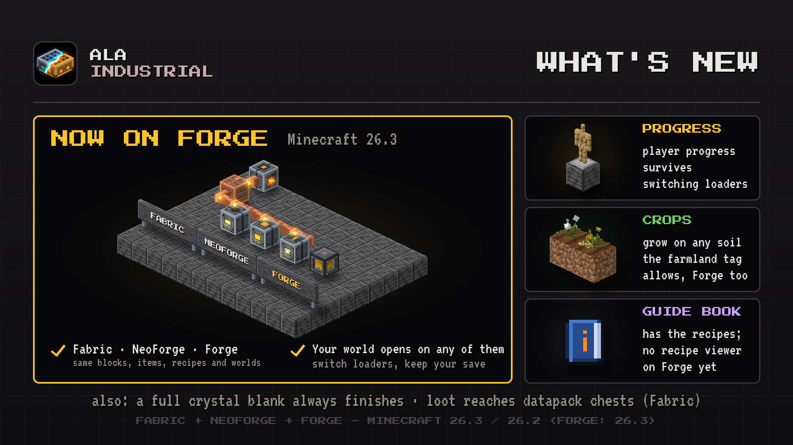

# Changelog

## 0.1.232

A full crystal blank always finishes, loot additions reach data pack chests, and your progress survives a change of mod loader.

### Bug Fixes

- **Crystal blanks.** A blank charged to the top always becomes a crystal, in any charging slot of the mod and in your inventory.
- **Loot additions.** In some builds of the mod they now reach chests whose loot table a data pack replaced, and the bonus chest switch applies without a reload.
- **Player progress.** Your profile and statistics in the mod survive opening the world with another mod loader.
