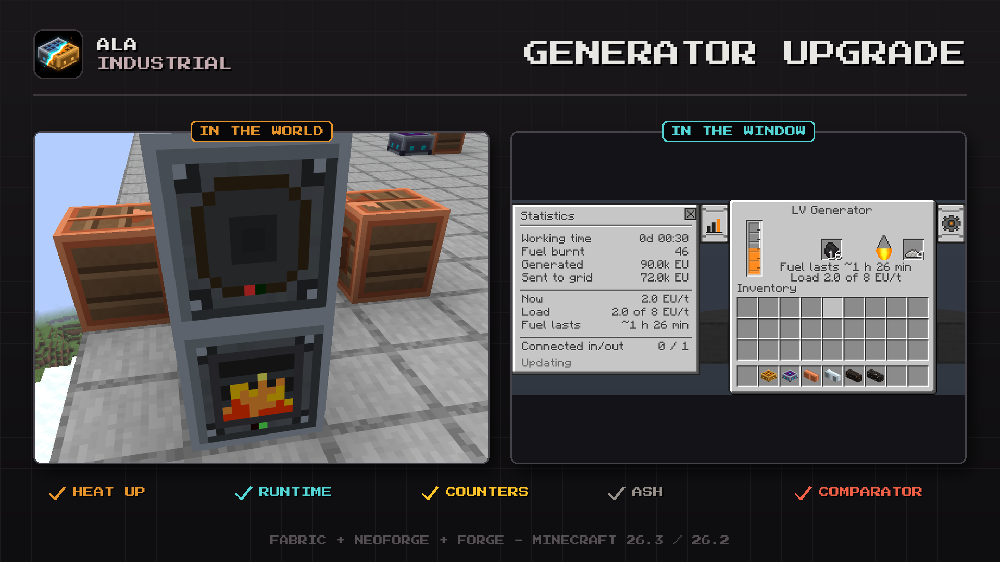

# Changelog

## 0.1.238

The coal generator now leaves ash, warms a Vulcanizer on top of it and, with the statistics chip, shows how long its fuel lasts.

### New

- **Ash from the generator.** The coal generator now leaves ash in its own slot: one ash for every 8 coal or charcoal burnt.
- **Generator heat.** A burning generator now heats a Vulcanizer standing on top of it, like a campfire.
- **Fuel runtime.** With the statistics chip, the generator window shows how long its fuel lasts at the current draw, and the draw itself.
- **Comparator on the generator.** A comparator now reads how full the generator's fuel slot is, like a furnace.
- **Burnt fuel counters.** The statistics chip now counts how much of each fuel the generator has burnt.

### Bug Fixes

- **Drone routes.** Drones no longer call a reachable stop unreachable, and the dispatcher has a show button for the stop's spot.
- **No wasted fuel.** Under a light load the generator now burns only as much fuel as the line actually draws.
