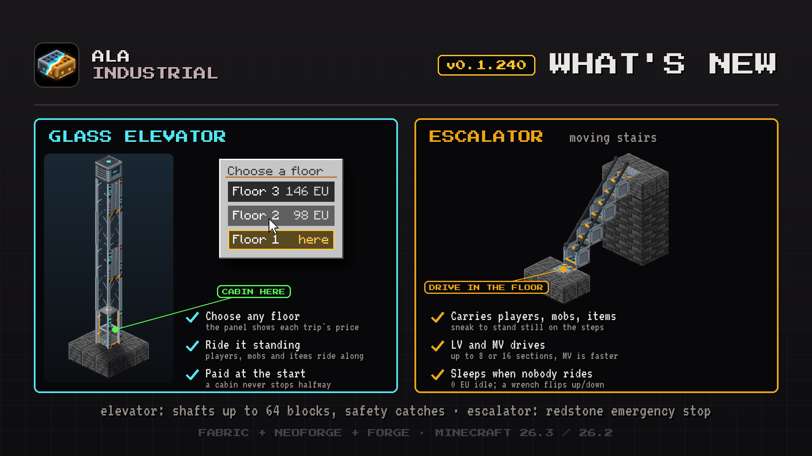

# Changelog

## 0.1.240

A glass elevator and an escalator join the mod: two new ways to move between floors.

### New

- **Elevator.** A glass shaft with a station on every floor and a winch on top. Ride it standing; a floor panel sends the cabin to any floor and shows the trip price.
- **Escalator.** Moving stairs with a glass balustrade and a drive set into the floor. It carries players, mobs and items up or down and sleeps when nobody rides.
