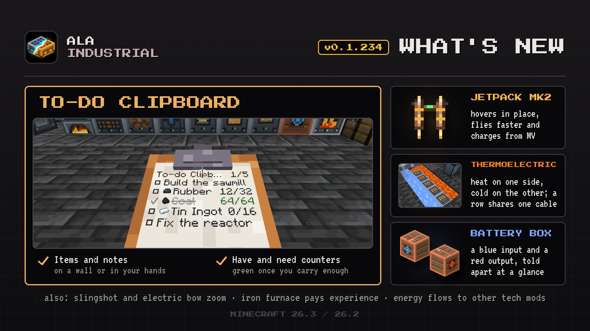

# Changelog

## 0.1.234

Keep a to-do list in your hands, hover with the Jetpack Mk2 and make power from heat beside cold.

### New

- **Thermoelectric Generator.** Makes power from heat on one face and cold on the opposite one, like lava against blue ice. A row of up to 8 touching generators shares one cable.
- **To-do Clipboard.** A list of items and notes to tick off, hung on a wall or read in your hands like a map. It counts what you have against what you need, and you choose who may edit it.
- **Slingshot in first person.** While you draw it, your other hand holds the pouch and the view zooms in as with a bow.
- **Jetpack Mk2.** A second jetpack made from the first one, with four times the charge and faster flight. Its hover mode holds you in the air, sinking slowly.

### Improved

- **Battery Box sides.** The input now has the same socket as the output, in blue, while the output stays red, so you can see which side to connect.
- **Iron Furnace experience.** It now gives smelting experience like a vanilla furnace, to whoever takes the result, or drops it when broken. Hoppers and pipes take items without it.

### Bug Fixes

- **Energy with other tech mods.** The mod's cables now pass full power into batteries and cables of other tech mods, and a charged battery of another mod powers the mod's blocks through them.
- **Oil lakes and Distant Horizons.** Faraway terrain no longer loses its lakes and other features because of an error in oil lake generation.
- **Piezo path with two cables.** Each cable now gets its share of the path's power; before, one of them could take it all and leave the other line empty.
- **Electric Bow zoom.** Drawing it now zooms the view like a bow and hides the item in your other hand.
- **Jetpacks on servers.** A long climb with any jetpack no longer gets you kicked from a server for flying.
