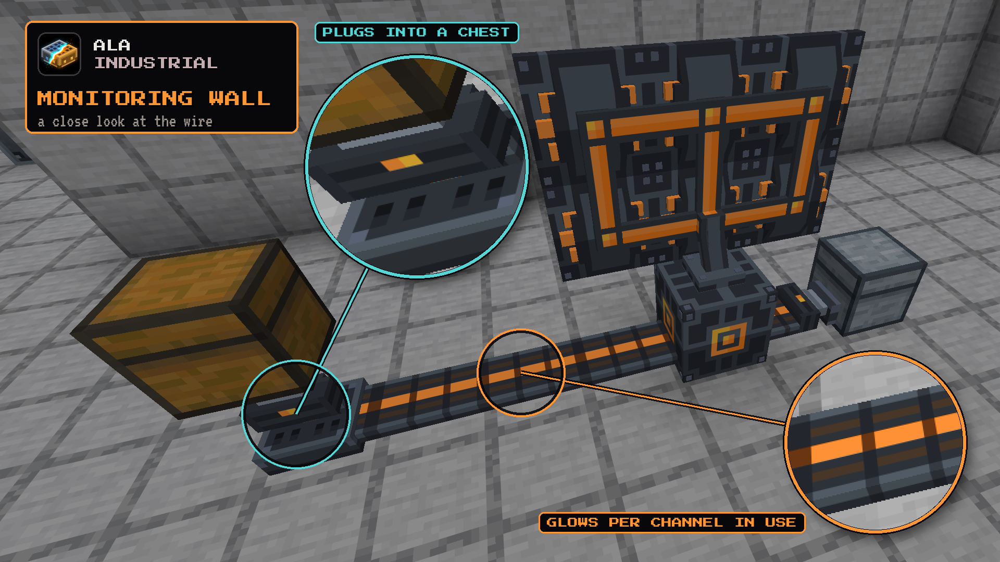

# Changelog

## 0.1.237

The monitoring wall gets visible wiring, and the Smart Wire becomes a ribbon that plugs straight into your chests.

### New

- **Monitoring wall wires.** Panels of one wall are linked by visible wires on the back, a panel on the core stands on a strut, and a screen glows only while it shows a live number.

### Improved

- **Smart Wire.** A flat ribbon that plugs into chests, barrels and shulker boxes, up to eight per wall, lighting one strand per storage in use. It no longer reads machines and costs more to craft.
